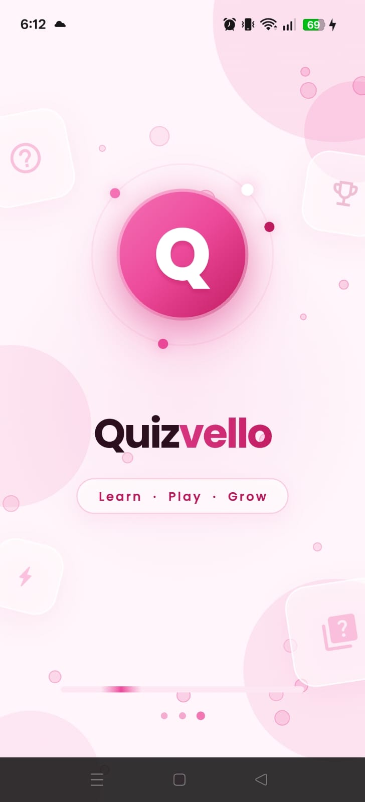
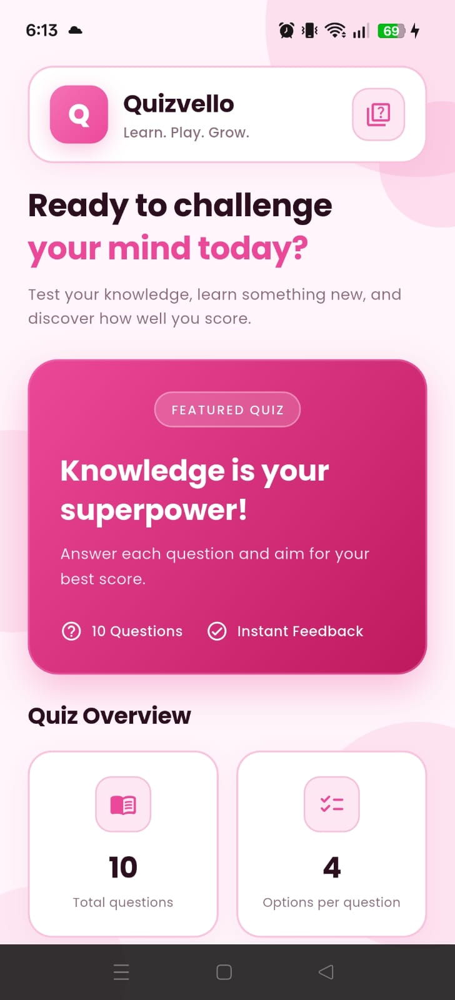
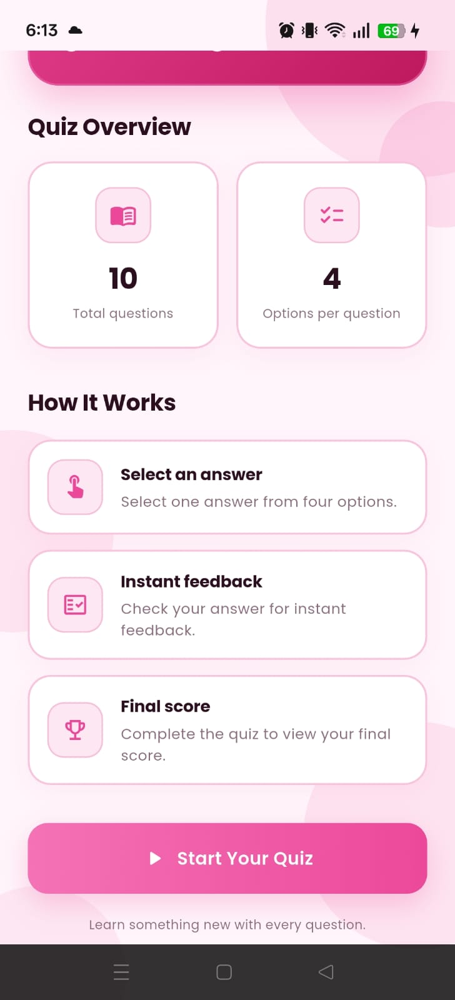
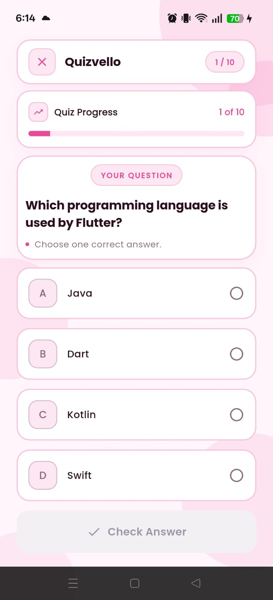
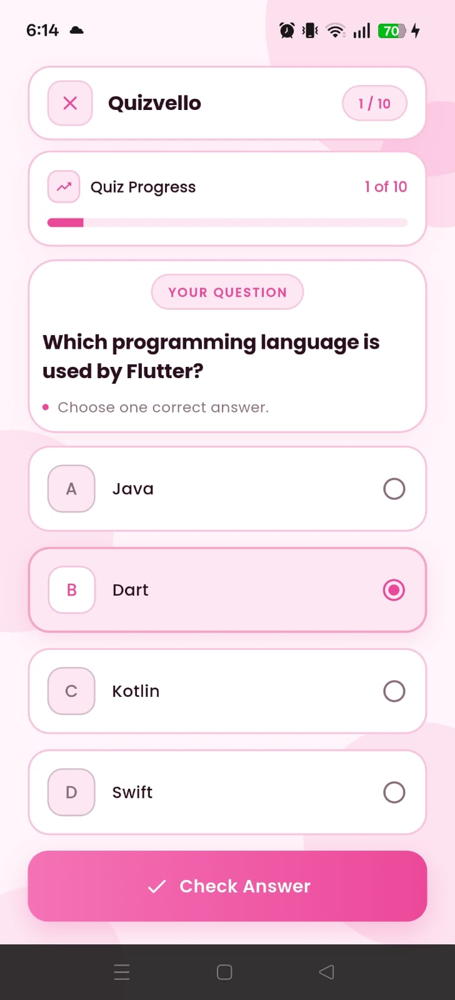
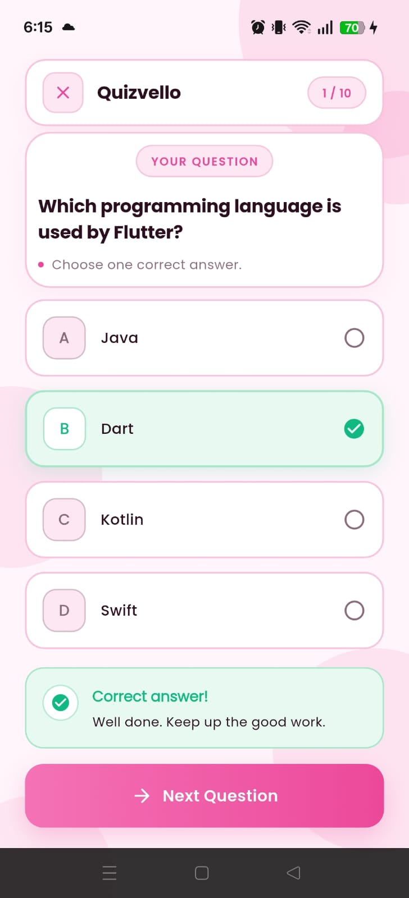
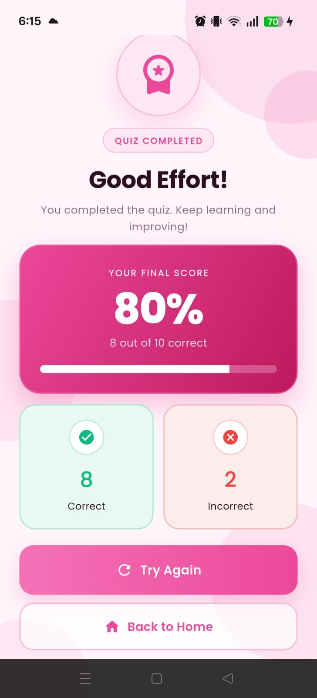

# Quizvello
Learn. Play. Grow.
Quizvello is a modern Android quiz application built with Flutter and Dart. It provides an interactive multiple-choice quiz experience with ten built-in questions, instant answer feedback, progress tracking, score calculation, and a final results screen.
This project was developed as Project 03 — Quiz App with Score Screen for The Sky Gen App Development programme. It focuses on Flutter UI development, screen navigation, state management, and reliable quiz and restart logic.
---
## App Overview
Quizvello includes a splash screen, a home screen, an interactive quiz flow, and a final score screen. Its questions are stored locally in the application code, so the quiz does not require an API, internet connection, or database.
---
## Key Features
- **Splash Screen:** Provides a branded introduction when the app launches.
- **Home Screen:** Displays the Quizvello branding and a button to start the quiz.
- **10 Built-in Questions:** Contains ten multiple-choice questions stored within the app.
- **Four Answer Options:** Each question provides four options and one designated correct answer.
- **Answer Feedback:** Selected answers receive visual feedback to indicate whether they are correct or incorrect.
- **Question Navigation:** Users progress through the quiz one question at a time.
- **Progress Indicator:** Displays the current question number and overall progress.
- **Score Screen:** Shows the final result and a performance message.
- **Restart Quiz:** Resets the quiz so users can attempt it again from the first question.
- **Return to Home:** Allows users to return to the home screen from the result screen.
- **Consistent UI:** Uses a coordinated colour palette, typography, and reusable widgets.
- **Offline Quiz Logic:** Questions, answer checking, and score calculation work without a backend or database.

## Screenshots

<table>
  <tr>
    <td align="center">
      <strong>Splash Screen</strong><br><br>
      
    </td>
    <td align="center">
      <strong>Start Screen</strong><br><br>
      
    </td>
<td align="center">
      <strong>Let's Start Screen</strong><br><br>
      
    </td>
  </tr>

  <tr>
    <td align="center">
      <strong>Question Screen</strong><br><br>
      
    </td>
<td align="center">
      <strong>Selected Option</strong><br><br>
      
    </td>
    <td align="center">
      <strong>Answer Feedback</strong><br><br>
      
    </td>
  </tr>
<tr>
    <td align="center">
      <strong>Score Screen</strong><br><br>
      
    </td>
  </tr>
</table>

---
## Demo Video

A 45–60 second demo showcasing the main features, including start screen, question screen, answer feedback, and score screen.

[Watch Demo Video](https://drive.google.com/file/d/1Jjk0X37UeKsJBuLRagQlS6FaD2XOPOAc/view?usp=sharing)

---
## Tech Stack

- **Flutter** — UI framework
- **Dart** — Programming language
- **Provider** — State management
- **Material Design 3** — UI design system
- **Google Fonts** — Typography

## Project Structure

The project is organized into core UI components and feature-specific files to keep the code maintainable.

```text
lib/
├── core/
│   ├── theme/                  # Central design system
│   └── widgets/                # Reusable shared widgets
└── features/
    ├── home/
    │   ├── screens/            # Home-screen UI and entry point to the quiz
    │   └── widgets/            # Reusable home-screen components
    └── quiz/
        ├── models/             # Data models representing quiz questions
        ├── providers/          # Quiz state, selected answers, score tracking, navigation state, and reset logic
        ├── screens/            # Quiz and result screens
        └── widgets/            # Question cards, answer options, progress indicators, feedback, and result components
```
## Architecture Responsibilities
- **core/theme/** — Shared application theme and styling.
- **core/widgets/** — Reusable UI components used across the app.
- **features/home/screens/** — Home-screen UI and entry point to the quiz.
- **features/home/widgets/** — Reusable home-screen components.
- **features/quiz/models/** — Data models representing quiz questions.
- **features/quiz/providers/** — Quiz state, selected answers, score tracking, navigation state, and reset logic.
- **features/quiz/screens/** — Quiz and result screens.
- **features/quiz/widgets/** — Question cards, answer options, progress indicators, feedback, and result components.
- **main.dart** — Application entry point and app-level configuration.
This separation makes the code easier to understand, maintain, test, and extend.
## Architecture

Quizvello follows a simple layered architecture using Provider for state management.

```text
                        
                            ┌──────────────────────────────────────┐
                            │          PRESENTATION LAYER          │
                            │       Screens and Reusable Widgets   │
                            └──────────────────┬───────────────────┘
                                               │ Reads state / sends actions
                                               ▼
                            ┌──────────────────────────────────────┐
                            │             STATE LAYER              │
                            │       QuizProvider (Provider)        │
                            │  Answers, score, progress, reset     │
                            └──────────────────┬───────────────────┘
                                               │ Reads
                                               ▼
                            ┌──────────────────────────────────────┐
                            │             DATA LAYER               │
                            │    QuizQuestion Model / Quiz Data    │
                            │        Ten Built-in Questions        │
                            └──────────────────────────────────────┘

```
---

## How the Quiz Works

- The application launches and displays the splash screen. 
- The user reaches the home screen and starts the quiz. 
- One question with four answer options is displayed at a time.
- The user selects an answer before proceeding.
- The app checks the selected answer and displays visual feedback.
- The progress indicator updates as the user advances through the questions.
- After all ten questions, the result screen displays the final score and performance message.
- The user can restart the quiz or return to the home screen.
---

## Application Navigation Flow

```text
┌─────────────┐    3s     ┌─────────────┐   Tap Start   ┌─────────────┐
│   Splash    │ ────────► │    Home     │ ────────────► │    Quiz     │
│   Screen    │           │   Screen    │               │   Screen    │
└─────────────┘           └─────────────┘               └──────┬──────┘
                                                               │
                                                           Complete
                                                               │
                                                               ▼
                                                        ┌─────────────┐
                                                        │   Result    │
                                                        │   Screen    │
                                                        └──────┬──────┘
                                                               │
                                          ┌────────────────────┴──────────────────┐
                                          │                                       │
                                      Try Again                               Back Home
                                          │                                       │
                                          ▼                                       ▼
                                   ┌─────────────┐                         ┌─────────────┐
                                   │    Quiz     │                         │    Home     │
                                   │   Screen    │                         │   Screen    │
                                   └─────────────┘                         └─────────────┘
```
## Getting Started

### Prerequisites

Install the following tools before running the project:

- Flutter SDK
- Dart SDK (included with Flutter)
- Android Studio or Visual Studio Code
- Android emulator or a physical Android device

### Installation

1. Clone the repository:

   ```bash
   git clone https://github.com/Atif798/quizvello.git
   
   ```

2. Open the project directory:

   ```bash
   cd quizvello
   ```

3. Install dependencies:

   ```bash
   flutter pub get
   ```

4. Run the application:

   ```bash
   flutter run
   ```

## Testing Checklist

The application was tested against the following scenarios:

- [x] App launches successfully.
- [x] Splash and home screens display correctly.
- [x] All ten questions can be completed.
- [x] Each question provides four answer options.
- [x] Correct and incorrect answer feedback is displayed.
- [x] Next is unavailable until an answer is selected.
- [x] Progress updates throughout the quiz.
- [x] The final score is calculated correctly.
- [x] Restart resets the score and returns to Question 1.
- [x] Return to Home works as expected.
- [x] The release APK installs and runs on a physical Android device.

### Static Analysis

`flutter analyze` completed with the following result:

```text
No issues found!
```
---
## Build Release APK

To generate a release APK, run:

```bash
flutter build apk --release
```

The APK will be generated at:

```text
build/app/outputs/flutter-apk/app-release.apk
```

Install and test the release APK on an Android device before distribution.

---

## Learning Outcomes

This project demonstrates practical experience with:

- Flutter UI development using reusable widgets.
- Managing application state with Provider.
- Implementing quiz navigation and answer selection.
- Calculating scores and resetting quiz state.
- Providing visual feedback and progress indicators.
- Building and testing an Android release APK.

## Project Links & Submission

- **GitHub Repository:** [Quizvello Source Code](https://github.com/Atif798/quizvello)
- **Google Drive Submission Folder:** [Open Submission Folder](https://drive.google.com/drive/folders/1F6-j6TyhNynxBqhtGY_FG1DnmXqF2pqW?usp=sharing)
- **Demo Video:** [Watch Quizvello Demo](https://drive.google.com/file/d/1Jjk0X37UeKsJBuLRagQlS6FaD2XOPOAc/view?usp=sharing)

**Submission note:** Ensure the Google Drive folder is shared with "Anyone with the link can view." Test the folder and video links in a private browser window before submitting.

## Developed By

**Developed By:** Atif Shehzad
